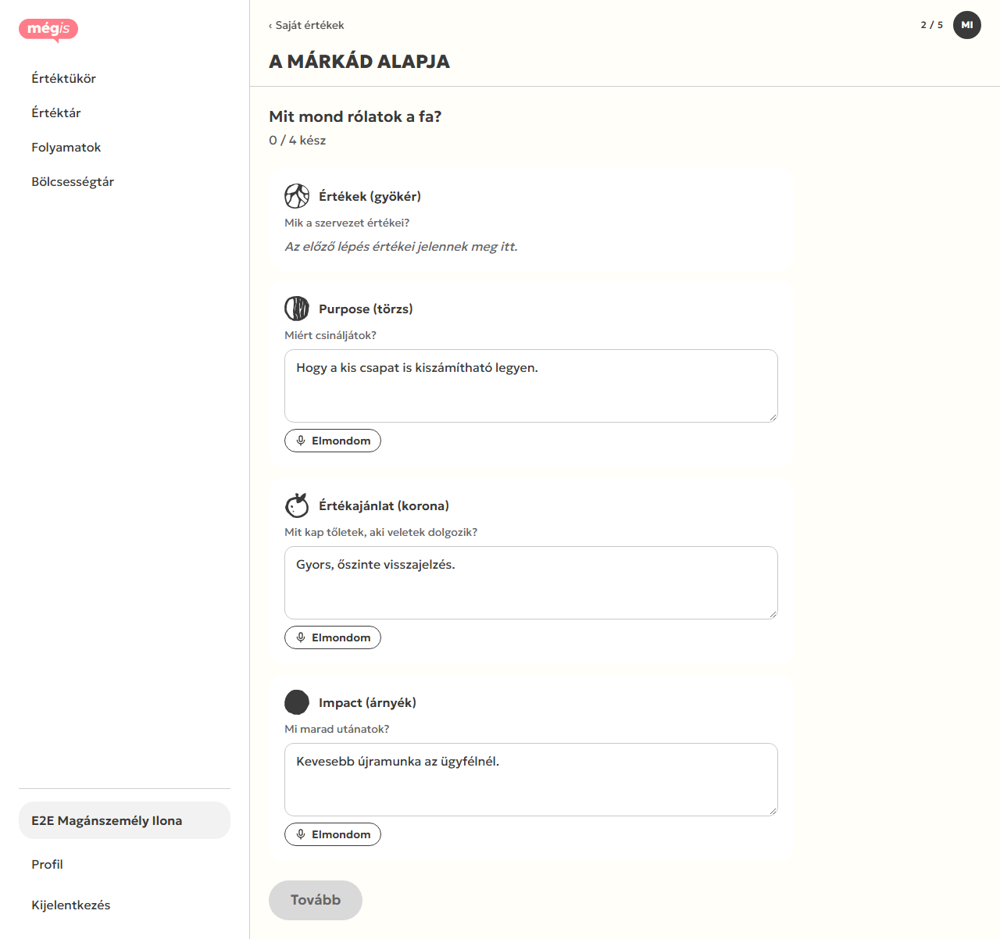
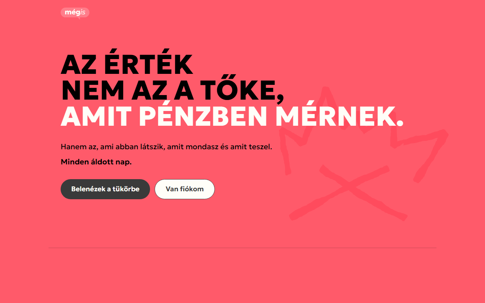
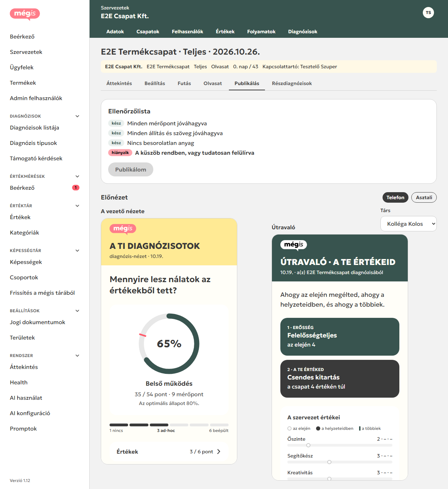
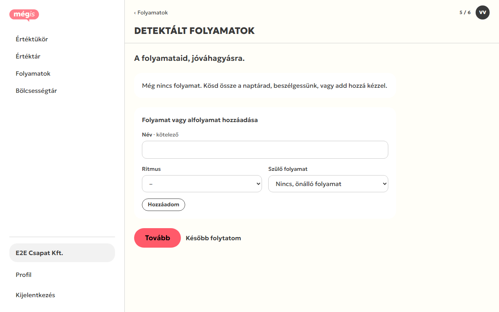
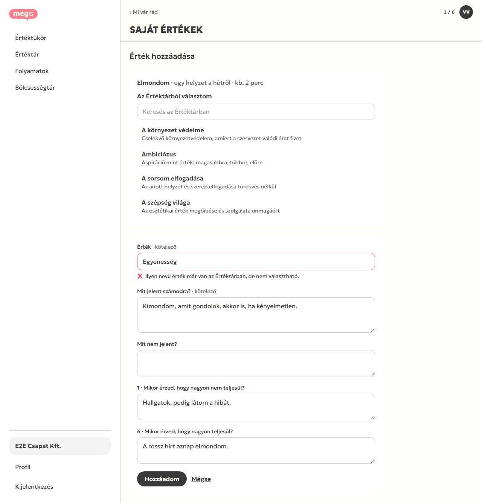
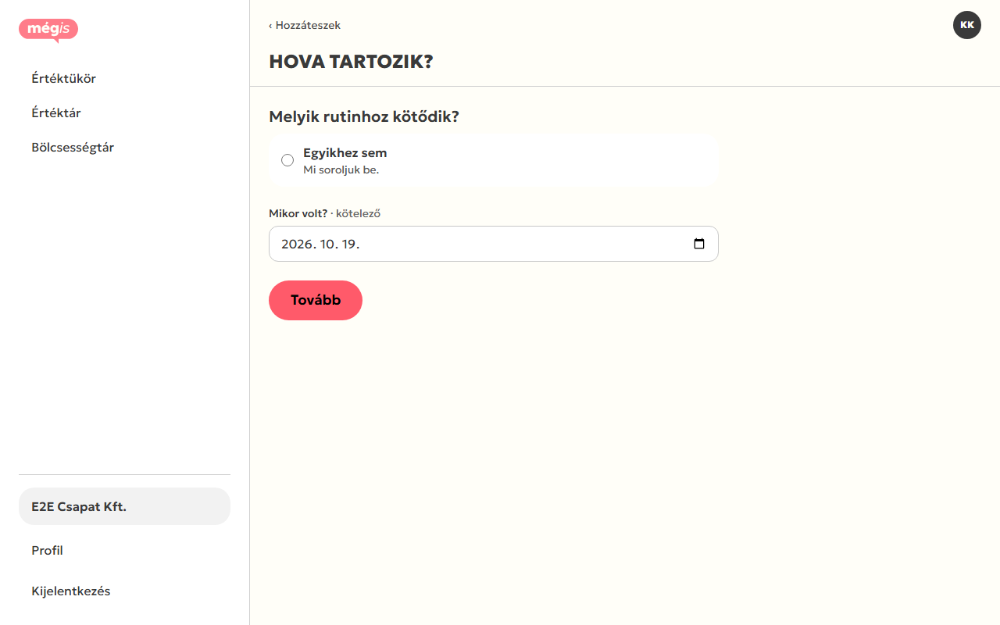
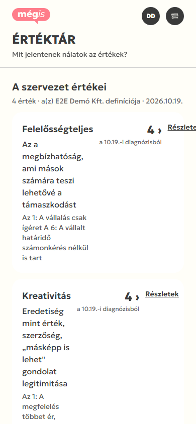

# Staging E2E teszt · 2026-10-19

Böngészős végigtesztelés a https://megis.exot.hu stagingen (1.12, deploy 2026-10-19 21:52, `1439cd6`). A tesztadatok `e2e-` előtaggal kerültek a közös `megis_dev` adatbázisba. Az elvárt viselkedés forrása a kód, a `docs/backlog` és a `prototype 3` képernyői.

## Összefoglaló

| Súlyosság | Db | Röviden |
|---|---|---|
| Blokkoló | 3 | V4 márka nem zárható le; fájlfeltöltés halott (3 helyen); küszöb alatti olvasat nem publikálható |
| Súlyos | 2 | Beszélgetésből (V6·c) nem lesz folyamat; Profil névmódosítás nem mentődik |
| Közepes | 6 | más szervezet AI-értéke blokkol; társ nem köt rutinhoz; 419 válaszvesztés; mobil Értéktár; AI-hallucináció; magánszemély szövegezése |
| Alacsony / kozmetikai | 12 | lásd lent |
| Kérdés (döntés kell) | 3 | lásd lent |

A három blokkoló közül kettő ugyanarra a gyökérokra vezethető vissza: **Livewire 4-ben más a `wire:model.blur` és a `$wire.upload` viselkedése, mint amire a kód épít**. Ezt a unit/feature tesztek nem fogják meg, mert közvetlenül a szerver-metódust hívják.

## Hogyan teszteltem

- **Böngésző:** Playwright (Chromium) a projekt `node_modules`-ából, asztali (1280×800) és mobil (390×844) nézetben. Minden oldalon figyeltem a JS-hibákat (`pageerror`, `console.error`), a ≥400-as válaszokat és a Livewire-kéréseket, és minden lépés után ellenőriztem a DB-t.
- **Turnstile:** a staging **valódi** site key-t használ (`0x4AAAA…`), ezt a headless böngésző nem kapja meg (Cloudflare 600010). A belépés egy sima, automatizálási jelzők nélkül indított Chrome-on át ment (CDP), a sütiket utána a headless futások vették át.
- **Ügyfél-belépés:** jelszóval. A meghívó-, belépőlink- és megerősítő tokenek `HMAC(APP_KEY)`-jel tárolódnak, a levelek pedig csak a staging logjába mennek (`MAIL_MAILER=log`). Ezért a regisztrációt a DB-ben szimuláltam (név + jelszó + `activated_at`, tagság `active`), a `/meghivo/{token}` oldalt pedig érvényes token nélkül nem tudtam végigvinni.
- **AI:** valódi Gemini-hívások a stagingen (14 db: Értéktükör, helyzetek, beszélgetés-kinyerés, olvasat-vázlatok).

## Javítások állapota (1.14, 2026-10-20)

A stagingen deploy után (`./update.sh`, a nézetek miatt `npm run build` is) érvényesek.

| Lelet | Állapot | Commit |
|---|---|---|
| B1 · V4 márka | javítva, böngészőteszttel | `5e09c2f` |
| B2 · feltöltés | javítva, arch-teszttel; deploy után a jogi dokumentumokat fel kell tölteni | `97c5c84` |
| B3 · küszöb-zsákutca | javítva; a diag 56 deploy után a Futás fülön felülírható | `a2960ce` |
| S1 · beszélgetés | javítva | `5351e4a` (és `5e09c2f`) |
| S2 · Profil név | javítva, böngészőteszttel | `5e09c2f` |
| K1 · más szervezet értékneve | **nyitott kérdés** | – |
| K2 · társ és rutin | **nyitott kérdés** | – |
| K3 · 419 válaszvesztés | enyhítve: a válaszok már kilépéskor mentődnek; a 419 oka nem derült ki | `5e09c2f` |
| K4 · mobil Értéktár | javítva, böngészőteszttel | `b740251` |
| K5 · AI-hallucináció | javítva (prompt v2) | `b77f39e` |
| K6 · magánszemély szövegezése | A1 névsúgó javítva; a V4 többes száma **nyitott kérdés** | `b0eca1b` |
| A1 · `$persist` | javítva, böngészőteszttel | `cd4afc7` |
| A2 · material 500 | javítva | `39f3c31` |
| A3 · státusztörténet | javítva | `290767c` |
| A4 · rés küszöb alatt | javítva (admin választó); a riport rés-kártyája **nyitott kérdés** | `3be7c33` |
| A5 · mérőpont-szám | **nyitott kérdés** | – |
| A6 · dupla logó | javítva | `4a32862` |
| A7 · azonos nevű szervezetek | javítva | `77f1f13` |
| A8 · „Feldolgozás alatt” | javítva | `e70259a` |
| A9 · újrapublikálás szövege | javítva | `703dd60` |
| A10 · „a mégis átnézte” | javítva | `8304a9e` |
| A11 · hiányzó `h1` | javítva, minden admin oldalra teszttel | `8d1e461` |
| A12 · demó-seeder | javítva; a stagingen már meglévő három „Demó ·” érték globális marad | `4c551e1` |
| Kérdések 1–3 | **nyitott kérdés** | – |

## Blokkoló hibák

### B1 · V4 „A márkád alapja”: a „Tovább” sosem aktiválódik, a diagnózis nem indítható

- **Kit érint:**
  - minden **magánszemély**-diagnózist (a márkát mindig ő tölti ki);
  - minden csapat-diagnózist, ahol a vezető szervezetvezető, és az admin nem töltötte ki előre a márkát.
- **Repró:** E2E Kevés Társ Kft. / diag 64 / Márk, illetve E2E Magánszemély Ilona / diag 74.
  1. V4 megnyitása: „1 / 4 kész” (magánszemélynél „0 / 4”), a „Tovább” le van tiltva.
  2. A Purpose, Értékajánlat és Impact mezők kitöltése, majd kilépés a mezőből.
  3. **0 Livewire-kérés megy ki.** A számláló nem változik, a „Tovább” letiltva marad.
  4. Újratöltés után a beírt szöveg elvész.
- **Elvárt:** blur után mentés, a számláló „4 / 4 kész”-re ugrik, a „Tovább” aktív.
- **Ok:** Livewire 4.4.7-ben a `wire:model.blur` `.live` nélkül **nem küld hálózati kérést**, csak a kliensoldali állapotot szinkronizálja (`vendor/livewire/livewire/dist/livewire.esm.js` ~17546–17590: `shouldSendNetwork = isLive || lazy`). Ezért a `Brand::updated()` nem fut le, a gomb pedig a szerveren számolt `:disabled="$canEdit && $doneCount < 4"` alapján marad letiltva.
  - Kódhelyek: `resources/views/livewire/client/diagnosis/brand.blade.php:56` és `:79`.
  - Ugyanez a minta van még itt: `organization-values.blade.php:46` (V3), `process-conversation.blade.php:19` (S1), `profile.blade.php:16-17` (S2), `occasion-experience.blade.php:11` (ez utóbbi ártalmatlan, a „Beküldöm” viszi).
  - Javítási irány: `wire:model.live.blur`.



### B2 · A fájlfeltöltés három helyen nem működik (`wire:submit="upload"` ütközés)

- **Repró:** fájl kiválasztása, majd „Feltöltöm” vagy „Új verzió feltöltése”. Konzol: `Livewire Expression Error: Cannot read properties of undefined (reading 'name') · Expression: "upload"`. Nem jön létre rekord, és a felhasználó semmilyen visszajelzést nem kap.
- **Ok:** a `$wire.upload(name, file, …)` a Livewire beépített, JS-oldali feltöltő metódusa. A `wire:submit="upload"` ezt hívja, nem a komponens `upload()` metódusát. Még a `$wire.call('upload')` és a `$wire.$call('upload')` is ide fut, tehát a szerveroldali metódus a böngészőből elérhetetlen.
- **Érintett helyek (mindhárom kipróbálva a böngészőben):**
  1. Admin · Beállítások · Jogi dokumentumok: `resources/views/livewire/admin/settings/legal-documents.blade.php:35`, `app/Livewire/Admin/Settings/LegalDocuments.php:52`
  2. Admin · Szervezet · Folyamat alkalmai: `process-occasions.blade.php:58`, `ProcessOccasions.php:48`
  3. Ügyfél · V11 Hozzáteszek · Feltöltés: `client/diagnosis/contribute.blade.php:26`, `Contribute.php:39`
- **Ugyanez a hiba:** a „Mégse” gomb (`wire:click="cancelUpload"`, `legal-documents.blade.php:52`) is Livewire-magic név, ezért nem zárja be az űrlapot.
- **Következmények:**
  - `legal_document_versions` üres: a publikus lábléc üres, és sehol nincs ÁSZF-, adatkezelési vagy cookie-link.
  - Az ET5 „Elfogadom az ÁSZF-et és az adatvédelmi szabályzatot” jelölőnégyzetnél nincs link, a felhasználó nem létező dokumentumot fogad el.
- **Javítási irány:** a metódusok átnevezése (pl. `saveUpload`, `closeUpload`).



### B3 · Küszöb-zsákutca: a küszöb alatt indított olvasat nem publikálható

- **Repró:** E2E Csapat Kft. / diag 56: 3 társ, 2 kitöltő (egy visszavont), publikálás 12.07.
  1. Futás: „A küszöbhöz még 1 kell.”, felülírás gomb nincs. Az „Olvasat indítása” csak egy általános megerősítést kér, és elindul.
  2. Olvasat: minden jóváhagyva (16/16, állítások 2/2, szövegek 6/6).
  3. Publikálás: „A küszöb rendben, vagy tudatosan felülírva — **hiányzik**”, a „Publikálom” letiltva. A link a Futás fülre visz, ahol **nincs felülírás gomb**.
- **Ok:** a felülírás doboza (`run.blade.php:17`) csak akkor jelenik meg, ha `stage === running` **és** a publikálásig kevesebb mint `THRESHOLD_WARNING_DAYS` nap van hátra (`DiagnosisRunService::thresholdAtRisk`, `DiagnosisRunService.php:163-171`). Olvasat szakaszban soha.
- **Elvárt:** vagy az olvasat indítása kérjen tudatos felülírást a küszöb alatt, vagy olvasatban is legyen felülírás.



## Súlyos hibák

### S1 · V6·c „Beszélgetésből”: begépelt válaszokból nem lesz folyamat

- **Repró:** diag 56 / Vera.
  1. Egy válasz beírása, majd „Válasz és tovább”.
  2. V6·d: „Még nincs folyamat.”
  3. DB: a `process_conversations.id=1` `extracts` mezőjében ott van a „Heti tervezés · weekly”, a `completed_at` 22:32:00. Az AI-hívás csak 22:32:05-kor futott le, a `processes` tábla üres.
- **Ok:** versenyhelyzet.
  - A `ConversationService::answer()` sorba állítja az `ExtractConversationProcesses` jobot.
  - A `finish()` (`ConversationService.php:136`) ugyanabban a kérésben, azonnal a még üres `extracts`-ból gyárt folyamatot, és lezárja a beszélgetést.
  - A B1-ben leírt blur-viselkedés miatt a begépelt válaszok **mindig** a „Válasz és tovább” kéréssel együtt mennek ki, így a kinyerés sosem előzi meg a lezárást.
  - A gomb „kinyerés folyamatban” állapotban sincs letiltva (`process-conversation.blade.php:66`).



### S2 · Profil: a vezeték- és keresztnév módosítása nem mentődik

- **Repró:** Klára / Profil.
  1. A keresztnév átírása „Klára-Teszt”-re, majd kilépés a mezőből: 0 Livewire-kérés.
  2. Újratöltés után újra „Klára”, a DB változatlan.
- Mentés gomb nincs, a felület automatikus mentést sugall.
- **Ok:** ugyanaz, mint B1: `profile.blade.php:16-17` (`wire:model.blur`), ezért a `Profile::updated()` (`Profile.php:84`) nem fut le.

## Közepes hibák

### K1 · Más szervezet AI-értéke blokkolja a saját érték nevét

- **Repró:** a V2-ben (Vera, E2E Csapat Kft.) új saját érték „Egyenesség” néven. Üzenet: „Ilyen nevű érték már van az Értéktárban, de nem választható.”
- **Ok:** az ütköző `values.id=179` a **Demó Kft.** (org 18) Értéktükréből jött, AI hozta létre (`origin=ai`), még nincs átnézve, és `has_endpoints=false`.
- **Következmények:**
  - Más szervezet adata blokkol, és el is árulja, hogy létezik.
  - A felhasználónak nincs kiútja: sem választani, sem felvenni nem tudja az értéket.



### K2 · Társ V11·b: a „Melyik rutinhoz kötődik?” lista üres

- A lista csak a `process_participants` alapján szűr (`OccasionService::eligibleProcesses`, `OccasionService.php:133`). Ez a spec szerint helyes („csak amelyekben benne van”), de:
  - Az Adatlapon beállítható **„Csapat(ok)” kapcsolatot figyelmen kívül hagyja**: a csapathoz kötött Sprint-retró a csapattag Kornélnak nem látszott, a résztvevőként felvett Heti tervezés igen.
  - Kézi vagy beszélgetéses úton résztvevő alapból nincs, és a V6 nem is kéri. Így a társak minden helyzete „Egyikhez sem”-be megy, vagyis admin-besorolásra.



### K3 · 419 Page Expired a V6·c-n, a válaszok elvesznek (időszakos)

- Az első „Válasz és tovább” 419-et kapott, a Livewire „This page has expired” ablaka után az oldal újratöltődött, és **mind a 4 beírt válasz elveszett**.
- Másodszorra nem jött elő, az okát nem találtam meg.
- Mivel a válaszok csak a lezáráskor mennek ki (lásd B1), egy lejárt munkamenet a teljes beírt szöveget elviszi.

### K4 · Mobil (390 px): az Értéktár vízszintesen túlcsordul

- `/e2e-demo/ertektar`: `scrollWidth 400 > 390`.
- A kártyán a definíció nagyon keskeny oszlopba szorul, a „Részletek” link pedig kilóg a képernyőről.
- A többi 14 ellenőrzött mobil oldalon nincs túlcsordulás.



### K5 · AI-olvasat: megalapozatlan összefoglaló

- Diag 56, „Összefoglaló · értékek” AI-vázlat: „A felelősségvállalás és a segítőkészség kimagaslóan erős nálatok…”
- E két értéknek **nincs pontszáma** (`no_trace`), csak az Őszinte kapott 3,0-t.
- Az admin jóváhagyja, de érdemes a promptban kizárni a nyom nélküli sorokat.

### K6 · Magánszemély: a szövegezés szervezeti

- V4 (Ilona): „Mit mond **rólatok** a fa?”, „Mik a **szervezet** értékei?”, „Miért **csináljátok**?”, „Mit kap **tőletek**…”.
- A1 névsúgó magánszemélynél: „Ha üresen hagyod: »**Csapat** · Termék · a kezdés napja«”.

## Alacsony / kozmetikai

| # | Hol | Mi |
|---|---|---|
| A1 | Admin belépés, jelszó-beállítás (`layouts/auth.blade.php`) | JS `pageerror`: „Cannot redefine property: $persist”. A layoutból hiányzik a `@livewireScriptConfig` (az admin, client és public layoutban megvan). A belépés ettől még működik. |
| A2 | `/admin/anyagok/{nem-uuid}` | 500-as hiba 404 helyett (pgsql uuid-cast). A `Material` route-kulcsa `uuid`, a route-on nincs `whereUuid`. |
| A3 | Admin diagnózis · Státuszváltások | Minden szakaszváltás „Draft → Draft”-ként látszik (meghívva, kitöltés, fut); a státusz jelenik meg a szakasz helyett. |
| A4 | Olvasat · A legnagyobb rés | 3 kitöltő alatt is „Őszinte (0,0)”-t kínál. |
| A5 | Admin · Diagnózisok · Kert | A diag 56-nál „10 mérőpont”, az Olvasat fül és a V10 szerint 16. |
| A6 | Kliens, asztali nézet (≥1200 px) | Két „mégis” logó: a bal menüben és a fejlécben is. |
| A7 | A1 szervezetválasztó | Azonos nevű szervezetek (2× „E2E Csapat Kft.”) megkülönböztethetetlenek, a slug nem látszik. |
| A8 | V11 Hozzáteszek | A „Feldolgozás alatt” címsor alatt „kész” állapotú helyzet áll. |
| A9 | Publikálás | A Visszavonás szerint „újrapublikáláskor nem megy ki e-mail”, az újrapublikálás megerősítő ablaka viszont „A vezető e-mailt kap…”. |
| A10 | Olvasat · Amit a vezető olvas | Jóvá nem hagyott („sejtés”) állítás mellett is „a mégis átnézte” felirat áll. |
| A11 | Admin · Szervezet · Adatok, Értékek | Nincs `h1` (akadálymentesség). |
| A12 | `DemoDiagnosisSeeder` | A hozzájárulás `text` mezőjébe a verziószám kerül (`:185`), az adminban „„2026-10-14” · 2026-10-14” látszik. A „Demó · …” értékek minden szervezet Értéktárában megjelennek. |

## Kérdések (döntést igényel, nem biztos, hogy hiba)

1. **V1:** ha az admin előre kitöltötte a szervezeti értékeket és a márkát, a vezető első belépéskor rögtön a V1·b-t kapja („Innen folytatod”, „Folytatom”) a „Kezdjük”-ös V1 helyett.
2. **A1:** 1 társsal is figyelmeztetés nélkül indítható, holott 3 kitöltő alatt nincs rés.
3. **Útravaló:** a kártyák számozása („1 · ERŐSSÉG”, „4 · RÉS · A TÖBBIEKTŐL”) nem egyértelmű.

## Ami működik

| Terület | Eredmény |
|---|---|
| Admin, 63 oldal smoke | minden 200 (kivéve A2), a Rendszer/Health rendben (worker és ütemező él) |
| Szervezet létrehozása és szerkesztése, csapat, tagok, csapatvezető, szervezeti értékek és márka | ✅ |
| A1 diagnózis-indítás (csapat, magánszemély), élő V1-előnézet | ✅ |
| Admin belépés, ügyfél jelszavas belépés, B2 kódoldal (újraküldés 60 mp után, hibás kód üzenet), lejárt/érvénytelen link és meghívó | ✅ |
| V1 → V2 → V3 → V4 → V5 → V6 (kézi lista, összegzés) → V9 „Indul a diagnózis” (előre kitöltött márkával) | ✅ |
| T1 hozzájárulás (a „Kezdem” hozzájárulás nélkül letiltva), T2/T3, T4, T5, T5·b | ✅ |
| V11 helyzet szövegesen: AI-feldolgozás, V11·b elhelyezés, V11·c megélés (vezető és társ) | ✅ |
| Hozzájárulás visszavonása: a vezető „2 / 3 kitöltötte” és „Még 1 társ hangja kell…”, a társ a visszavonás üzenetét látja | ✅ (a speckel egyezik) |
| Admin Futás, „Olvasat indítása”, AI-vázlatok (állítások, szövegek), soronkénti és blokk-jóváhagyás, kézi pontozás | ✅ |
| Publikálás, fagyasztott riport, visszavonás (riport 403, Útravaló 404, „A mégis javítja…”), újrapublikálás | ✅ |
| Riport R0–R9, RM, minden tételoldal (36 oldal), 14+7+20+16 = 57/90 = 63% konzisztens | ✅ |
| Riport PDF (34 KB) és Útravaló PDF (20 KB) | ✅ 200, érvényes PDF (a tartalmat nem rendereltem) |
| Fejezet-visszajelzés („Részben” + szöveg), megjelenik az admin Beérkezőben | ✅ |
| Társ: Útravaló T6 elérhető, a riport 403 | ✅ |
| Publikus Értéktükör ET2 → ET3 → ET5 valódi AI-val (63 mp), fiók-létrehozás → „Nézd meg a leveled” | ✅ |
| Belépés a nevében: kliensoldal nyílik, Értéktükör 403, fióktörlés rejtve, „Kilépés” | ✅ |
| Admin feltöltés (`/admin/diagnozisok/feltoltes`): beszélő-hozzárendelés, AI-elemzés, „kész” | ✅ |
| Profil: jelszócsere (hibás régi jelszó → „A jelszó helytelen.”) | ✅ |
| Offline: service worker → „Nincs internet” | ✅ |
| Mobil (390 px): 15 oldalból 14 túlcsordulás nélkül, menü működik | ✅ |

## Nem tesztelt (és miért)

- **Meghívó-regisztráció (`/meghivo/{token}`), belépő link, kódos belépés sikeres ága, Értéktükör-megerősítés:** érvényes tokenhez a staging APP_KEY vagy a staging levél-log kellene.
- **Naptár-összekötés (Google/Microsoft OAuth), hangfelvétel és diktálás:** headless böngészőben nincs mikrofon; a staging `MEGIS_TRANSCRIBER=fake`.
- **Küszöb-felülírás funkció:** a B3 miatt a felületről nem érhető el; DB-ből nem állítottam be.
- **„Kevés társ” állapot a publikált riportban (R2 szürke szöveg):** a B3 miatt a diag 56 nem publikálható.
- **Fióktörlés:** szándékosan kihagytam.
- **Képességtár importja, „Snapshot · Külső”:** utóbbi szándékosan folyamat nélküli.
- **Automatikus akadálymentességi (axe) ellenőrzés:** nem futott; csak a hiányzó `h1`-et láttam.

## Konfigurációs észrevételek (staging)

- **Turnstile:** valódi site key, ezért az automatizált (Playwright) teszt csak sima Chrome-on át megy. Staging-teszthez érdemes visszaállni a Cloudflare teszt-kulcsaira (`1x00000000000000000000AA`).
- **`MEGIS_BOOKING_URL` üres:** az ET5-ön nincs „Időpontot foglalok”.
- **`ai_calls.cost_usd = 0`** mind a 14 Gemini-hívásnál: a `config/ai.php`-ban nincs Gemini-ár.
- **Beérkező:** van egy korábbi „Nem tudtuk feldolgozni: Nyilvános Értéktükör” sor, és 1 sikertelen job („The transcript is empty”, 18:15).

## Létrehozott tesztadat

| Mi | Azonosító |
|---|---|
| Adminok | `e2e-superadmin@example.com` (64), `e2e-admin@example.com` (65) |
| E2E Csapat Kft. | org 19, diag 56 (olvasat), vezető `e2e-vezeto@`, társak `e2e-kollega2..4@` |
| E2E Kevés Társ Kft. | org 20 (slug `e2e-csapat-kft-2`), diag 64 (kitöltés, a V4-en elakadva), `e2e-vezeto2@`, `e2e-tars21@` |
| E2E Demó Kft. | org 21 (`e2e-demo`), diag 65 (publikálva, 2 fagyasztott riport), `e2e-demo-dora/denes/dalma/daniel/diana@` |
| E2E Magánszemély Ilona | org 22, diag 74 (kitöltés, a V4-en elakadva), `e2e-ilona@` |
| Értéktükör | mirror_session 6 (`e2e-tukor@`, nem megerősített) |
| Saját értékek az Értéktárban | Kimondott igazság, Megbízhatóság a csapatban, Csendes kitartás, Tisztelet, E2E Kíváncsiság, Közös döntéshozatal |

Minden tesztfelhasználó `@example.com` címen van, ugyanazzal a jelszóval (a jelentésben nem szerepel). Jogi dokumentumot nem töltöttem fel (B2). A tesztadatok a hibák reprodukálásához bent maradtak. Takarításhoz ezzel lehet összegyűjteni őket (csak olvas):

```php
// php artisan tinker
DB::table('users')->where('email', 'like', 'e2e-%@example.com')->pluck('id', 'email');
DB::table('organizations')->where('slug', 'like', 'e2e-%')->pluck('id', 'slug');
```
